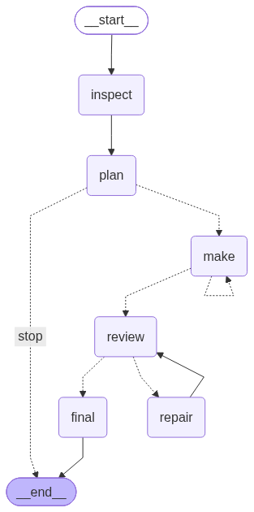
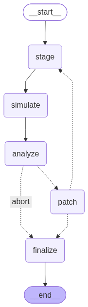

# EDA 课程设计进度报告

| 项 | 内容 |
| --- | --- |
| 题目 | 题目三 · 任务一 —— 基于国产大模型与 LangGraph 的仿真与验证平台自动化生成 |
| 基线版本 | EDA Agent v8.2 |
| 报告版本 | v1.2（2026-10-22，补充网页分析面板与导出） |
| 代码位置 | `E:\LangGraph` |
| 运行环境 | Windows + Python 3.13.9（venv） / VMware NAT 虚拟机 `192.168.81.128`（RHEL6，Synopsys VCS I-2014.03_Full64） |
| 文档性质 | 进度报告（非最终课程设计报告） |

## 目录

- [1 一页结论](#1-一页结论)
- [2 设计思路](#2-设计思路)
- [3 实现方式](#3-实现方式)
- [4 验证方法](#4-验证方法)
- [5 结果与分析](#5-结果与分析)
- [6 对照课设要求的完成度](#6-对照课设要求的完成度)
- [7 已知问题与限制](#7-已知问题与限制)
- [8 后续计划](#8-后续计划)
- [9 附录](#9-附录)

---

## 1 一页结论

| 课设要求 | 当前状态 | 证据位置 |
| --- | --- | --- |
| 需求解析 → 代码生成 | ✅ 已实现（StateGraph，6 节点） | `eda_agent_v8_core.py` |
| 仿真执行 | ✅ 已实现（工具封装 + 人工触发） | `eda_remote_v8.py` |
| 结果分析 | ✅ 失败分类 + 日志摘录 + `[FAIL]` 模式聚合 | `eda_graph.py` |
| 迭代纠错闭环 | ✅ 已实现为 StateGraph 子图（5 节点 + 条件边） | `eda_graph.py` |
| 覆盖率报告 | ✅ 已接入 VCS `-cm` + `urg` | `run_summary.json.coverage` |
| 至少 3 轮迭代实验 | ✅ 基线 + 4 轮（v1→v5） | §5.2 |
| 工程通用性（三个设计） | ✅ 计数器 / FIFO / 256 位加法器均独立跑通 | §5.7 |
| 课程设计报告 | ❌ 未开始（本文仅为进度版） | — |

**一句话**：五个阶段现在都是 StateGraph 节点（生成层一张图、闭环层一张子图），硬性功能要求只剩「正式报告」未完成。

---

## 2 设计思路

### 2.1 题目理解

课程要求构建 LangGraph 工作流，从 RTL 设计描述自动生成 Testbench、仿真脚本与覆盖率报告，并形成「生成—验证—纠错」闭环。核心验收点是**真实 EDA 工具反馈驱动**，而不是模型自称成功。因此本项目的判定一律以 VCS 退出码 + 日志标记为准，`finished_unverified` 不计为通过。

### 2.2 总体架构

```
┌──────────────────────── Windows ────────────────────────┐
│  Streamlit 网页 (web_app_eda_v8.py)                      │
│    ├─ 对话 / 生成 / 草稿审批                              │
│    ├─ ① SSH 探测  ② 上传  ③ VCS 仿真  ④ 自动纠错闭环       │
│    └─ 覆盖率展示 / 日志查看 / 补丁 diff / 人工采纳          │
│                                                          │
│  LangGraph 生成层 (eda_agent_v8_core.py)                  │
│    inspect → plan → make → review → repair → final        │
│                                                          │
│  自动纠错子图 (eda_graph.py)                              │
│    stage → simulate → analyze →(patch → stage | finalize)  │
│                                                          │
│  远程工具层 (eda_remote_v8.py)                            │
│    Paramiko SSH/SFTP + 固定命令模板（不执行模型生成的 shell）│
└──────────────────────────┬───────────────────────────────┘
                           │ SSH / SFTP（NAT 192.168.81.128）
┌──────────────────────────┴───────────────────────────────┐
│  Linux 虚拟机 (RHEL6, IC 用户)                             │
│  /home/IC/Desktop/EDA_Projects/<工程名>/                   │
│    ├─ .eda_agent_project.json   绑定 chat_id，防串用        │
│    ├─ inputs/ generated/        已批准源码                  │
│    ├─ history/                  同名更新前的备份            │
│    └─ runs/vcs_NNN/             不可变快照 + build + 日志    │
│         ├─ src/                本轮源码（SHA-256 清单）     │
│         ├─ build/vcs_compile.log / vcs_sim.log / cov.vdb   │
│         └─ run_summary.json                                 │
└──────────────────────────────────────────────────────────┘
```

### 2.3 关键设计决策

| 决策 | 理由 |
| --- | --- |
| 每轮独立快照，禁止覆盖 | 迭代记录必须可复核；旧轮源码/日志是实验证据 |
| 自动纠错只写 `shadow/iter_NN` | 不污染用户已审批的 `generated/`，采纳前必须人工确认 |
| 远程只跑固定命令模板 | 阻止模型生成的 `rm -rf` 等任意 shell |
| 环境类错误不改 RTL | license/网络/磁盘问题改代码没有意义，且会伪造因果 |
| 断言失败禁止改 Testbench | 防止通过放宽检查「骗过」测试，掩盖 RTL 缺陷 |
| 覆盖率与纠错分开跑 | VCS 2014 在 `-cm` 收尾阶段存在偶发崩溃（见 §7） |
| 生成与闭环分成两张图 | 中间夹着人工审批/采纳边界，见 §3.0 |

**假设条件**：虚拟机由人工保证可用；VCS/DC/ICC 许可证有效；`IC` 为普通用户，不使用 root；SSH 主机密钥已人工核验一次。

---

## 3 实现方式

### 3.0 两张协作的图

系统的 LangGraph 部分由**两张协作的图**组成：

| 图 | 文件 | 节点 | 边界 |
| --- | --- | --- | --- |
| 图 1 生成层 | `eda_agent_v8_core.py` | inspect / plan / make / review / repair / final | 产出草稿，**必须人工审批**才落盘 |
| 图 2 闭环层 | `eda_graph.py` | stage / simulate / analyze / patch / finalize | 消费已批准源码，产出补丁建议，**必须人工采纳**才写回 |

两张图通过 `run_autofix()` 衔接，中间的**人工审批/采纳**是刻意保留的安全边界（防止模型产出未经确认就上传到 Linux）。

### 3.1 模块职责

| 文件 | 大小 | 职责 |
| --- | --- | --- |
| `web_app_eda_v8.py` | 44 KB | Streamlit 界面、会话存储、四个操作入口 |
| `eda_agent_v8_core.py` | 27 KB | LangGraph 生成工作流（inspect/plan/make/review/repair/final） |
| `eda_remote_v8.py` | 34 KB | SSH/SFTP、隔离上传、VCS 与 urg 调用、日志回收 |
| `eda_graph.py` | 10 KB | **新增**：自动纠错闭环的 StateGraph（5 节点 + 条件边） |
| `eda_autofix.py` | 9 KB | 闭环的节点实现与补丁校验、diff、人工采纳（`run_autofix` 转发到图） |
| `autofix_cli.py` | 3 KB | **新增**：闭环的命令行验收入口 |
| `first_do.py` | 2 KB | **新增（本机）**：DeepSeek `llm` 对象，惰性初始化 |
| `test_v8_2_offline.py` | 8 KB | 离线回归（不连虚拟机） |
| `eda_analysis.py` | 5 KB | **新增**：从会话历史 + 本地日志汇总每轮指标，供网页分析面板与 Markdown 导出 |
| `graph.py` / `langgraph.json` | 2.7 KB | 独立示例图（学习/演示用，未接主流程） |

### 3.2 StateGraph 节点与状态（生成层）



| 节点 | 输入 | 输出 | 说明 |
| --- | --- | --- | --- |
| `inspect` | `root` | `available, index` | 盘点工作空间已有文件 |
| `plan` | `question, available` | `plan, references` | LLM 规划文件清单（JSON） |
| `make` | `plan[i]` | `drafts[i]` | 逐文件生成，防覆盖已有文件 |
| `review` | `drafts` | `issues, review_status` | 静态审查（语法/端口/文件名一致性） |
| `repair` | `issues` | `drafts` | 针对静态问题的修复 |
| `final` | `drafts` | `answer` | 汇总，等待人工审批保存 |

条件边：`plan →(stop/make)`、`make →(make/review)`、`review →(repair/final)`。

> `repair` 只消费**静态审查**结果，不消费 VCS 日志；仿真反馈由闭环子图处理。

### 3.3 自动纠错闭环（StateGraph 子图）



`get_graph()` 实测边：

```
start → stage → simulate → analyze
analyze → patch        （compile / assertion / no_marker）
analyze → finalize     （通过 / environment / simulator_crash / 轮数用尽）
patch   → stage        （补丁有效，进入下一轮）
patch   → finalize     （补丁校验失败或与现状一致）
finalize → end
```

**节点接口（`LoopState`）**

| 字段 | 类型 | 写入节点 | 含义 |
| --- | --- | --- | --- |
| `iteration` | int | stage | 当前轮次 |
| `stage_dir` | str | stage | 本轮影子目录 |
| `run` | dict | simulate | `run_label/status/exit codes/coverage/logs` |
| `status` | str | simulate | VCS 判定 |
| `error_type` | str | analyze | 失败分类 |
| `log_excerpt` | str | analyze | 头 45% + 尾 55% 日志 |
| `failure_summary` | str | analyze | `[FAIL]` 模式聚合 |
| `history` | list | analyze | 每轮记录（含覆盖率、改动文件） |
| `working` | dict | patch | 当前源码（只存在于内存与影子目录） |
| `error` | str | analyze/patch | 中止原因 |
| `ok` / `final_status` / `diffs` | — | finalize | 终态汇总 |

**单轮流程**：stage 写快照 → simulate 跑 VCS → analyze 分类并聚合失败模式 → patch 生成并校验补丁 → 回到 stage；`recursion_limit = 4 × max_iterations + 10`。

### 3.4 失败分类规则

| 类型 | 触发 | 处理 |
| --- | --- | --- |
| `compile` | `Error-[SE/VA/PA/CL]`、syntax/parse error | 交给模型修 |
| `assertion` | `[FAIL]` / `TEST FAILED` | 交给模型修（只能改 RTL） |
| `no_marker` | 退出码 0 但无 PASS 标记 | 视为未验证，交给模型补检查 |
| `environment` | license/网络/超时/权限 | **中止** |
| `simulator_crash` | `fatal signal` / `unexpected termination` | **中止** |

> 分类顺序是「工具崩溃 → 语法错误 → 环境错误 → 退出码」，因为 VCS 版权声明里含有 `license agreement` 字样，早期版本曾把它误判成许可证问题。

### 3.5 关键提示词（摘录）

```
你是 Verilog/SystemVerilog 修复助手。根据编译或仿真日志定位缺陷，
只修改真正有问题的文件，其余保持原样。
只输出一个 JSON 对象，形如
{"reason":"一句话说明改了什么、为什么","files":[{"path":"generated/rtl/x.v","content":"完整文件内容"}]}。
content 必须是可独立编译的完整文件，不是 diff、不是片段。
不要修改模块名、文件名和端口列表，除非日志明确说明它们不一致。
Testbench 是验证依据：禁止通过放宽检查、删除断言、修改期望值来让测试通过；
断言失败时优先修改 RTL 的逻辑错误。
不得输出任何命令、脚本或与 JSON 无关的解释。
```

### 3.6 网页端结果分析面板

报告里的分析结论不是孤证：Streamlit 页面在 SSH 面板下方提供「📊 结果分析（本对话）」，直接渲染同源数据。

| 区块 | 内容 |
| --- | --- |
| 指标卡 | 累计运行次数、通过率、最新覆盖率（含相对基线增量）、检查点数（含增量） |
| 逐轮明细 | 运行标签、状态、检查点、**通过数**、失败数、**场景数**、**种子数**、**功能覆盖 bins**、覆盖率、仿真结束时刻、编译/仿真退出码、**结束标记** |
| 趋势图 | 覆盖率折线（仅统计接入 urg 的运行）、检查点柱状图 |
| 失败轮次 | 按 `exp/got` 聚合的失败模式，与喂给模型的摘要一致 |
| 导出 | 「⬇️ 导出分析摘要（Markdown）」生成 `分析摘要_<会话短ID>.md`，可直接粘进报告 |

**数据来源**（只读本地文件，不连虚拟机）：

| 字段 | 来源 |
| --- | --- |
| 运行标签 / 状态 / 覆盖率 / 退出码 | `chat.json` 的 `remote_history` |
| 检查点数 / 失败数 / `$finish` 时刻 | 每轮 `remote_runs/<id>/vcs_sim.log` |
| 失败模式 | 同一日志中的 `[FAIL] ... exp=%h got=%h` |

这样做的目的是让**报告里的每个数字都能在页面上当场复现**，避免出现“文档写一套、系统跑一套”的情况。

---

## 4 验证方法

### 4.1 Testbench 五个版本

| 版本 | 定位 | 比对方式 | 场景/覆盖点 | 检查点 |
| --- | --- | --- | --- | --- |
| v1 | 基线 | 硬编码期望值 | 5 场景 | 260 |
| v2 | 优化 1 | 参考模型逐拍比对 + 200 次随机 | 9 场景 | 864 |
| v3 | 优化 2 | v2 + 窄脉冲 / 背靠背 / 长保持 / 复位优先级 | 13 场景 | 924 |
| v4 | 优化 3 | v3 + 10 个功能覆盖点 + 3 个随机种子 | 10 bins | 1031 |
| v5 | 优化 4 | v4 + 负向测试（验证比较器本身） | 11 bins | 1032 |

共同约定：结束打印 `total checks / passed / failed` 与 `TEST PASSED / TEST FAILED`；`[FAIL]` 只用于真实失败，故意失败打 `[XFAIL]`，避免污染流水线判定。

### 4.2 验证场景与功能覆盖点（v5）

**场景（14 类）**：上电复位、复位保持、连续计数、计数中异步复位、`en` 边沿时序、窄复位脉冲、背靠背复位、50 拍长保持、复位与 `en` 同时变化、`0x7F` 处复位、`0xFF` 回绕、`0xFF` 处复位、负向检查、3 个种子的随机操作（共 300 次）。

**功能覆盖点（11 个 bin）**：上电复位 / 保持 / 计数 / 回绕 / 异步复位 / 窄脉冲 / 背靠背 / 长保持 / 复位优先级 / 随机复位 / 负向检查。结尾打印 `functional coverage = 11/11 bins`。

功能覆盖与代码覆盖率分开统计、分开报告，避免把「测试通过」当成「覆盖率高」。

### 4.3 正确性判据

- 每个检查点与参考模型逐拍一致
- 结束打印 `TEST PASSED` / `TEST FAILED (n errors)`
- 判定以 VCS 退出码 + 日志标记为准，`finished_unverified` **不计为通过**

---

## 5 结果与分析

### 5.1 主工程运行台账（`counter_v82`）

| 运行 | TB 版本 | 覆盖率 | 状态 | 说明 |
| --- | --- | --- | --- | --- |
| `upload_001` | — | — | uploaded | 首次上传快照 |
| `vcs_001` | v1 | — | passed_by_marker | 首次真实 VCS 通过（260 检查点） |
| `vcs_002` | v1 | — | passed_by_marker | 重复验证 |
| `vcs_003` | v1 | — | passed_by_marker | 重复验证 |
| `vcs_004` | v1 | 88.53 | passed_by_marker | **基线覆盖率**（流水线产出） |
| `vcs_005` | v2 | 93.06 | failed | TB 自身建模缺陷，57 处 FAIL（见 §5.5） |
| `vcs_006` | v2 | 92.53 | passed_by_marker | **第 2 轮通过**（864 检查点） |
| `vcs_007` | v3 | 92.79 | passed_by_marker | **第 3 轮通过**（924 检查点） |
| `vcs_008` | v3 | 92.79 | passed_by_marker | 网页「④ 闭环」端到端验证（1 轮通过，无补丁） |
| `vcs_010` / `vcs_012` | v3 | 92.79 | passed_by_marker | 重复运行，检查点与覆盖率同 `vcs_007` 完全一致（可复现性） |
| `vcs_014` | v4 | — | compile_failed | `bins` 是 SystemVerilog 保留字，VCS 拒绝（见 §5.5 #7） |
| `vcs_015` | v4 | 92.88 | passed_by_marker | **优化 3 通过**（1031 检查点 / 10 bins） |
| `vcs_016` | v5 初版 | 90.05 | passed_by_marker | 负向测试引入不可达分支，覆盖率反降（§5.2 观察 5） |
| `vcs_017` | v5 | 93.05 | passed_by_marker | **优化 4 通过**（1032 检查点 / 11 bins） |

### 5.2 覆盖率演进（基线 + 4 次优化）

| 轮次 | 运行 | TB | 检查点 | 场景 / bins | 总分 | 行覆盖 | 分支覆盖 | 翻转覆盖 |
| --- | --- | --- | --- | --- | --- | --- | --- | --- |
| 基线 | `vcs_004` | v1 | 260 | 5 场景 | 88.53% | 90.14% | 80.00% | 95.45% |
| 优化 1 | `vcs_006` | v2 | 864 | 9 场景 | 92.53% | 97.58% | 80.00% | 100.00% |
| 优化 2 | `vcs_007` | v3 | 924 | 13 场景 | 92.79% | 98.37% | 80.00% | 100.00% |
| 优化 3 | `vcs_015` | v4 | 1031 | 10 bins | 92.88% | 98.65% | 80.00% | 100.00% |
| 优化 4 | `vcs_017` | v5 | 1032 | 11 bins | **93.05%** | **99.14%** | 80.00% | 100.00% |
| 对照（未采用） | `vcs_016` | v5 初版 | 1032 | 11 bins | 90.05% | 98.72% | **71.43%** | 100.00% |

**观察 1：提升主要来自 Testbench，不是 DUT。**
基线时 DUT（`counter_8bit`）的行覆盖与分支覆盖就已是 100%，三轮提升的实际来源是 Testbench 自身被更多执行（v1 的 TB 行覆盖仅 89.55%、分支 50%）。对这么小的 RTL，代码覆盖率已无法再区分「验证是否更充分」，真正变化的是场景数。

**观察 2：分支覆盖 80% 是结构性的。**
DUT 100% 与 TB 约 50% 的加权结果。TB 里 `$display("[FAIL]...")` 与最终 `TEST FAILED` 分支只在真实失败时执行，测试全过时必然不覆盖。这是「测试通过」与「分支覆盖最大化」的固有矛盾。

**观察 3：边际收益递减。**
v2→v3 增加 60 个检查点，总分 +0.26；v3→v4 增加 107 个检查点、10 个功能覆盖点，总分 +0.09；v4→v5 增加负向测试，总分 +0.17。代码覆盖率已接近饱和，后续迭代的指标应从「代码覆盖率」转向「功能场景 + 断言强度」。

**观察 4：`vcs_005` 的 93.06% 是虚高。**
那一轮 TB 自身有缺陷，57 处 `[FAIL]` 触发错误分支，覆盖率反而高于修好后的 92.53%。该数据保留在台账中，但不计入迭代收益。

**观察 5：增加测试代码可能让指标下降（负结果）。**
v5 初版加入负向测试后，总分从 92.88% 掉到 90.05%，分支覆盖从 80.00% 掉到 71.43%——因为新增的两个 `if/else` 中，else 侧（真实失败路径）永远不可达，分母变大而分子只加一。改为「无分支自校验」（把断言写成 `errors = errors - 1`，比较器失效时 errors 变负、最终判定自然失败）后回升到 93.05%。这条对比记录保留在表中，说明**覆盖率不是单调的，加代码也可能降指标**。

**观察 6：为什么到不了 100%。**
除非真的出现设计失败，`[FAIL]` 打印与 `TEST FAILED` 分支不会执行。因此 100% 与「测试全过」在逻辑上互斥；试图靠伪造失败刷到 100% 属于数据造假，工程上应如实报告 93.05% 并解释缺口来源。

### 5.3 迭代效率与成本

| 轮次 | 检查点 | 仿真结束 | 仿真 CPU | 编译 CPU | 覆盖率 |
| --- | --- | --- | --- | --- | --- |
| v1 | 260 | 2.686 µs | 0.09 s | 0.116 s | 88.53% |
| v2 | 864 | 8.636 µs | 0.09 s | 0.118 s | 92.53% |
| v3 | 924 | 9.206 µs | 0.14 s | 0.543 s | 92.79% |
| v4 | 1031 | 10.266 µs | 0.28 s | 0.346 s | 92.88% |
| v5 | 1032 | 10.266 µs | 0.28 s | 0.406 s | 93.05% |

**分析**：

- 检查点数增长 3.97 倍（260→1032），仿真时间增长 3.8 倍（2.686→10.266 µs），仿真 CPU 从 0.09 s 增到 0.28 s——**仍然是可以忽略的量级**。
- 单轮墙钟 5~19 秒（含 SSH 上传、VCS 编译、仿真、urg 收尾），闭环两轮（失败+修复）通常 30~40 秒。
- 迭代成本几乎全在远程执行与网络，不在仿真本身；因此「多写测试」在这个规模上几乎没有成本，真正的成本是人工设计与调试。

### 5.4 故障注入实验分析

| 案例 | 注入故障 | 失败轮证据 | 模型定位 | 修复轮 | 墙钟 |
| --- | --- | --- | --- | --- | --- |
| ① 语法错误 | 删除 RTL 第 13 行分号 | `compile_failed`，退出码 255，`Error-[SE] Syntax error ... token is 'end'` | 「补上缺失的分号」 | `passed_by_marker` | 5 s + 19 s |
| ② 逻辑错误 | 删除 `en` 门控 | `failed`，324 处 `[FAIL]`，以 `exp=00 got=01` 为主 | 「RTL 未使用 en 信号，改为仅 en=1 时递增」 | `passed_by_marker`（864 全过） | 14 s + 14 s |

**分析**：

1. **定位准确、改动最小**。两个补丁都只有一行：① 补一个 `;`；② `end else begin` → `end else if (en) begin`。没有出现“重写整个文件”或“顺手改无关代码”的情况，说明日志摘录 + 失败模式聚合提供了足够的定位信息。
2. **失败模式聚合确实降低了难度**。案例② 的原始日志有 324 行 `[FAIL]`，直接喂给模型既超长又噪声大；聚合成「共 324 处，最常见 exp=00 got=01（8 次）、exp=00 got=02（6 次）…」之后，模型只看到 5 类模式就定位到了 `en` 门控。
3. **两个案例都在 1 次重试内解决**（要求 1~3 次），且失败轮与修复轮日志、源码快照全部保留，满足“可复核”。
4. **补丁没有触碰 Testbench**。案例② 是断言失败，按闸门规则禁止改 `generated/tb/`，模型也确实只改了 RTL——这道闸门没有触发拒绝，说明提示词约束生效。

### 5.5 过程中发现并修复的缺陷

| # | 现象 | 根因 | 处理 |
| --- | --- | --- | --- |
| 1 | 离线测试在 Windows 必失败 | `write_text` 把 `\n` 转成 `\r\n`，与字节比对断言冲突 | 测试显式 `newline='\n'` |
| 2 | v2 首跑 57 处 FAIL | TB 参考模型在复位释放后漏跟一拍 | 释放后补 `next_cycle()` |
| 3 | 语法错误被判成 license 问题 | 环境关键字用了裸 `license`，命中 VCS 版权声明 | 语法错误优先 + 关键字收紧 |
| 4 | 仿真器 `fatal signal` 被判成断言失败 | 未区分工具崩溃与设计错误 | 新增 `simulator_crash` 类别并中止 |
| 5 | 覆盖率统计把未改动文件也重写 | `adopt_result` 未比对内容 | 仅写入真正变化的文件 |
| 6 | 网页默认 IP 回退到旧地址 | UI 默认值写死 `192.168.79.129`，重启后静默回退 | 改为读 `.env`，默认 `192.168.81.128` |
| 7 | VCS 编译报 `token is 'bins'` | `bins` 是 SystemVerilog 保留字；ModelSim 放过、VCS 拒绝 | 变量改名 `cov_bins` |
| 8 | v5 初版覆盖率反降（92.88%→90.05%） | 负向测试新增两个 `if/else`，else 侧不可达，分支覆盖 80%→71.43% | 改为无分支自校验，回升到 93.05% |

> 第 2 条最有价值：**随机化测试首次运行就暴露了测试平台自身的时序建模缺陷**。这不是失败，而是“验证方法有效”的证据——硬编码用例的 v1 跑了三轮都没发现它。

### 5.6 有效性威胁（Threats to Validity）

| 类型 | 说明 | 影响 |
| --- | --- | --- |
| 外部效度 | 只验证了一个 8 位计数器，RTL 仅 17 行 | 结论不能外推到多模块、含存储器/接口的复杂工程 |
| 构念效度 | 覆盖率主要反映 TB 代码执行情况 | 代码覆盖率不能等同于验证充分性，必须配合场景清单 |
| 内部效度 | 闭环只测了两个注入故障 | 对时序违例、多驱动、跨模块端口错误等尚无证据 |
| 工具限制 | VCS 2014 + 2 GB 虚拟机；`-cm` 收尾偶发崩溃 | 覆盖率与闭环不能同时开启（见 §7） |
| 自动化边界 | 生成与采纳都需人工确认 | “自动闭环”指分析与修复自动，审批仍由人把关 |

### 5.7 工程通用性（三个设计）

为避免「只对一个设计调通」的质疑，另做了两个结构完全不同的设计，走同一条流水线：

| 项 | 计数器 `counter_v82` | 同步 FIFO `fifo_sync_v1` | 256 位加法器 `cla256_v1` |
| --- | --- | --- | --- |
| RTL 文件数 | 1 | 1 | **6（4 层层次）** |
| 总源文件 | 2 | 2 | **7** |
| 检查点 | 924 | 351 | **1005** |
| 覆盖率总分 | 92.79% | 96.61% | **99.47%** |
| 行覆盖 | 98.37% | 97.73% | **99.47%** |
| 条件覆盖 | — | **100.00%** | — |
| 分支覆盖 | 80.00% | 90.00% | **99.67%** |
| 翻转覆盖 | 100.00% | 98.72% | 99.27% |
| 判定 | passed_by_marker | passed_by_marker | passed_by_marker |

**分析**：

1. **流水线不含设计假设**：工程名、模块名、顶层 TB 全部参数化，三个设计从上传到出覆盖率均未改动流水线代码。
2. **多文件工程无需手写 filelist**：加法器由 `top_adder → CLA_256 → CLA_64/16/4/3_C` 四层组成，7 个源文件由 `source_manifest` 自动收集并按相对路径传给 VCS，编译顺序由工具解析，不依赖 `.f` 文件。
3. **覆盖率随设计结构变化**：计数器 92.79%（受限于 TB 错误分支）、FIFO 96.61%（条件判定多）、加法器 99.47%（纯组合逻辑 + 1005 个测试向量，接近饱和）。
4. **换设计时最需要适配的是测试平台约定**：FIFO 首次在 ModelSim 跑出 12 个 FAIL，定位为 TB 自身缺陷（`wire` 连续赋值比 `check` 晚一个 delta）；加法器 TB 的原始输出格式（`PASS :` / `ERROR:`）不匹配流水线判定协议，需改为 `[PASS]` / `[FAIL]` 才能被识别为通过。判定条件本身未改动。
5. **已知边界**：加法器 RTL 来自本机实验工程 `D:\adder`，仅在本地做通用性验证，未随交接包分发。

### 5.8 P1 评估报告整改记录

第三方对仓库的 P1 评估提出 4 条意见，逐条处理如下：

| 评估意见 | 处理 | 证据 |
| --- | --- | --- |
| 1. 扩展日志解析，输出通过数、场景、随机种子、功能 bin 与结束标记 | ✅ 已实现并展示 | `eda_analysis.py` 解析 `total/passed/failed`、`scenarios`、`seed=`、`functional coverage`、`TEST PASSED`；面板新增列与「最新一轮」摘要 |
| 2. 归档各轮源码快照与 `snapshot_manifest.json`，使 SHA-256 可核对 | ✅ 已归档并校验 | 6 轮 × 2 个源码文件，逐项哈希与清单一致；已过滤 `csrc/` 等 VCS 编译产物 |
| 3. 补齐基线与早期轮次日志 | ✅ 已归档 | `evidence/counter_v82/` 现含 `vcs_004`（基线）、`vcs_005`（失败样本）、`vcs_006`（优化 1） |
| 4. 增加汇总解析的离线测试 | ✅ 已实现 | `test_analysis_offline.py`：4 条用例（v5 全字段、v1 降级、失败轮、导出） |

**说明**：快照与清单通过 `fetch_evidence.py` 从虚拟机拉取。注意 `runs/<label>/src/` 里还混有 VCS 运行时生成的 `csrc/`、`cm.log`、`ucli.key`，脚本只按清单下载源码，避免把编译产物（约 27 个/轮）误当快照归档。

### 5.9 小结

1. 五阶段工作流已经以两张 StateGraph 的形式落地，仿真反馈真正驱动了修改，而不是模型自述成功。
2. 三轮迭代把检查点从 260 提到 924、场景从 5 提到 13，代码覆盖率从 88.53% 提到 92.79%；但**增益主要来自 Testbench 与场景覆盖**，这一点必须如实说明。
3. 闭环在两个注入故障上都以 1 次重试完成修复，补丁最小、可复核、未触碰 Testbench。
4. 换两个结构完全不同的设计（同步 FIFO、四层 256 位加法器）仍能独立建工程、跑通 VCS 并产出覆盖率，其中加法器 7 个源文件由 `source_manifest` 自动收集，证明流水线具备工程通用性且不依赖手写 filelist。
5. 剩余工作的重心应从“刷覆盖率”转向“补强断言 + 撰写报告”。

---

## 6 对照课设要求的完成度

| 要求 | 完成情况 | 证据 |
| --- | --- | --- |
| 解释 StateGraph/Node/Edge/条件分支 | ✅ 已在 §3.2/§3.3 整理 | 本文档 |
| 画出工作流架构图 | ✅ 图 1、图 2 | §3.2 / §3.3 |
| 定义各节点输入输出接口 | ✅ 节点表 + `LoopState` 字段表 | 本文档 |
| 大模型 API 接入 | ✅ DeepSeek `deepseek-v4-pro` | `first_do.py` |
| 工具函数封装（仿真器调用/报告解析） | ✅ `remote_job` / `_parse_coverage` | `eda_remote_v8.py` |
| 状态管理实现 | ✅ 生成层 `WorkState`，闭环层 `LoopState` | `eda_agent_v8_core.py` / `eda_graph.py` |
| 自动生成 TB | ✅ | `generated/tb/tb_counter_8bit.v` |
| 自动执行仿真并解析日志 | ✅ | `runs/vcs_00N/build/*.log` |
| 结果分析可视化 | ✅ 页面面板 + Markdown 导出 | §3.6 |
| 形成「生成—验证—纠错」闭环 | ✅ 闭环子图已实现并验证 | `eda_graph.py` |
| 覆盖率报告 | ✅ VCS `-cm` + `urg` | `covReport/dashboard.txt` |
| 至少 3 轮迭代实验 | ✅ 5 轮记录（基线 + 4 次优化，含 1 次负结果对照） | §5.2 |
| 换工程仍可用 | ✅ FIFO（351 检查点）与 256 位加法器（7 源文件、1005 检查点）均独立跑通 | §5.7 |
| 报告中的提示词、日志、截图 | ⚠️ 提示词与日志有，波形/截图待补 | §3.5 |

---

## 7 已知问题与限制

1. **架构上分为两张图（设计选择）**：生成层与闭环层分开，中间是人工审批/采纳边界。代价是若严格要求「五个阶段在同一张图内」，还需定义父图状态（`WorkState` + `LoopState` 并集）并用 `add_node(subgraph)` 合并；当前按两张协作图交付，答辩时应说明该取舍的理由。
2. **覆盖率与纠错互斥**：VCS 2014 在 `-cm` 收尾阶段偶发 `fatal signal`（虚拟机资源充足，`/home` 仅用 18%、内存可用 1.7 GB），暂以 `EDA_COVERAGE=0` 规避。
3. **Streamlit 前端 `removeChild` 异常**：勾选日志/切换控件时偶发，浏览器关闭自动翻译可缓解；不影响后台运行。
4. **Python 版本**：本机 3.13.9，交接文档建议 3.10.11，目前未发现不兼容。
5. **报告要素缺项**：逻辑综合/后端 PPA/DRC/LVS 等条款按题目三任务一可能不适用，需与任课教师确认。
6. **数据目录**：会话固定写 `C:\LangGraph_talk`，C 盘空间需留意。
7. **闭环运行不入会话历史**：`④` 与 CLI 的闭环运行不写 `chat.json` 的 `remote_history`，排查时需看 `shadow/` 目录或 `autofix.log`。

---

## 8 后续计划

| 优先级 | 任务 | 产出 | 预估 |
| --- | --- | --- | --- |
| **P1** | 撰写正式课程设计报告（按 PDF 目录，附日志/截图与心得 300 字） | 报告书 | 2 天 |
| ~~P1~~ | ~~补第二/第三个设计验证通用性~~ | ✅ 已完成：FIFO 351 检查点、加法器 1005 检查点 / 7 源文件 | — |
| **P2** | 恢复 `-cm` 与闭环并存（错峰或改用 `-cm` 后单独跑 urg） | 覆盖率与纠错同跑 | 0.5 天 |
| **P2** | 修复 `removeChild`、配置外置、闭环运行写入历史 | 稳定性 | 1 天 |
| **P3（可选）** | 合并为单图：父图 `generate → autofix → report`，审批改为 `interrupt` 节点 | 一张总图 | 0.5~1 天 |
| **P3（可选）** | 接入 DC/ICC（独立工作库，禁止复用旧 `adder` 工程） | 综合/后端结果 | 视课时 |

---

## 9 附录

### 9.1 复现命令

```powershell
cd E:\LangGraph

# 离线回归（不连虚拟机）
.\venv\Scripts\python.exe test_v8_2_offline.py

# 启动网页
.\venv\Scripts\streamlit.exe run web_app_eda_v8.py --server.headless true --server.port 8501

# 自动纠错闭环验收（密码运行时输入）
$env:EDA_COVERAGE='0'
.\venv\Scripts\python.exe -u autofix_cli.py --workspace E:\LangGraph\sandbox_autofix2 --project counter_autofix4
```

### 9.2 关键产物位置

| 内容 | 路径 |
| --- | --- |
| 会话与运行记录（Windows） | `C:\LangGraph_talk\conversations\<对话>\` |
| 本地日志副本 | `<会话>\remote_runs\<run_id>\` |
| 远端工程 | `/home/IC/Desktop/EDA_Projects/<工程名>/` |
| 快照哈希清单 | `runs/vcs_NNN/snapshot_manifest.json` |
| 覆盖率原始报告 | `runs/vcs_NNN/build/covReport/dashboard.txt` |
| 影子目录（纠错） | `<workspace>\shadow\<id>\iter_NN\` |
| 闭环图 / 生成层图 | `report/loop_graph.png`、`report/gen_graph.png` |
| 分析摘要导出 | 网页「📊 结果分析」→ 下载 `分析摘要_<会话短ID>.md` |
| 各轮快照与哈希清单 | `evidence/counter_v82/<label>/src/`、`snapshot_manifest.json`（由 `fetch_evidence.py` 归档） |
| 第二/第三设计 | `designs/fifo/`、`evidence/fifo_sync_v1/`（交接包内）；加法器仅日志 `evidence/cla256_v1/` |

### 9.3 图表索引

| 编号 | 内容 | 文件 |
| --- | --- | --- |
| 图 1 | 生成层 StateGraph | `report/gen_graph.png` |
| 图 2 | 闭环层 StateGraph | `report/loop_graph.png` |

---

*本报告为进度版，用于对照课程要求梳理现状；正式报告需补波形截图、完整日志附录与心得体会。*
